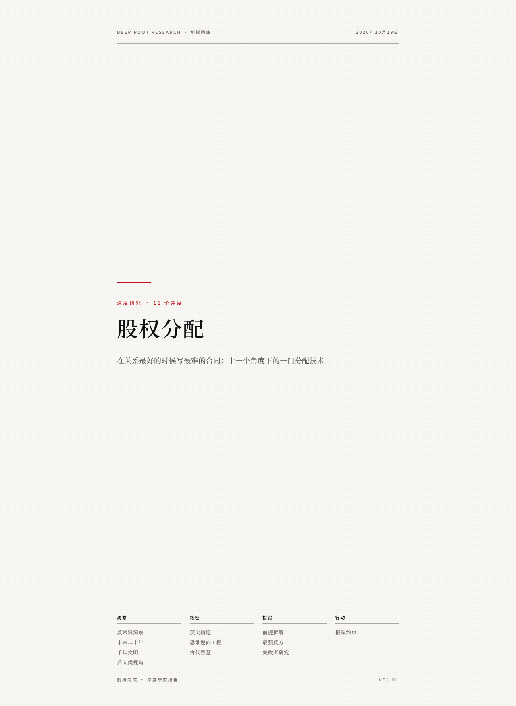
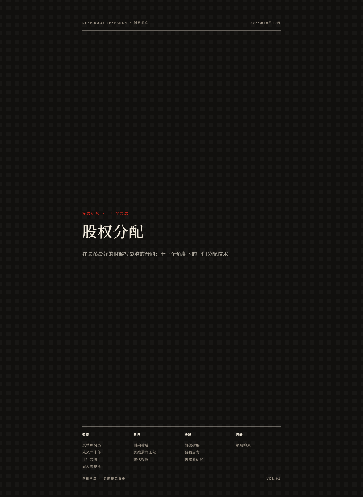

# 刨根问底 · paogen-wendi

对任意主题按 11 个深度研究角度完成分析，产出一本杂志级排版的研究报告（HTML + PDF）。

日式极简杂志风：黑白双色调、中国红唯一装饰色、思源宋体＋思源黑体、红色下沉花体首字、纸感网点纹理、A4 全出血分页。

## 11 个研究角度

| 分组 | 角度 |
|---|---|
| 洞察 | 反常识洞察 · 未来二十年 · 千年文明 · 后人类视角 |
| 路径 | 顶尖精通 · 思维逆向工程 · 古代智慧 |
| 检验 | 前提拆解 · 最强反方 · 失败者研究 |
| 行动 | 极端约束 |

每个角度一章，每章 3～4 个分析点，分析点必须标注证据等级（事实 / 推断 / 思想实验），并过「深度三问」：有可验证细节？有机制解释？有边界条件？

## 快速开始

对任意 AI Agent（Claude Code / Codex / WorkBuddy 等）说一句：

> 用刨根问底 skill 深度分析【某主题】

Agent 会按 `SKILL.md` 的工作流执行：联网核查事实 → 按角度研究 → 写内容 JSON → 一条命令出报告。

手动生成：

```bash
python scripts/build_report.py content-a.json content-b.json \
  -o "刨根问底-主题.html" --theme white --pdf
```

- `--theme white` 白纸黑字 / `--theme midnight` 黑底白字，同一次内容可以各出一份。
- `--pdf` 调用 `scripts/make_pdf.py`（Edge 无头打印，自动处理中文路径与字体加载）出同名 PDF。

## 目录结构

```
paogen-wendi/
├── SKILL.md                 # Agent 工作流入口
├── scripts/
│   ├── build_report.py      # 内容 JSON -> HTML（多文件合并、--pdf 连动）
│   └── make_pdf.py          # HTML -> PDF（Edge 无头）
├── assets/
│   ├── template.html        # 全部样式与版式（双主题）
│   └── sample-content.json  # 示例内容（间隔重复记忆）
├── examples/                # 真实主题的内容 JSON 样例
├── references/
│   ├── angles.md            # 11 角度方法论 + 深挖指令 + 质量门槛
│   └── design-system.md     # 排版设计规范
└── docs/                    # 效果预览截图
```

## 效果预览

| 白主题 | 黑主题 |
|---|---|
|  |  |

## 设计原则

- **约束优于自由**——样式全部固化在 `assets/template.html`，模型只产内容 JSON，不写 CSS，换模型不走样。
- **证据分层**——事实 / 推断 / 思想实验三级标签贯穿全文，脚本强制校验 `ev` 字段。
- **确定性下沉**——平台与排版硬规则交给脚本（校验、合并、打印），模型只做内容判断。
- **克制用色**——黑、白、中国红三色理论，红色只出现在锚点（章号、下沉首字、规线、标签、编号）。

## 环境要求

- Python 3.10+（仅标准库，无第三方依赖）
- Microsoft Edge（PDF 转换用；HTML 本身任何浏览器可开）
- 联网（模板从 Google Fonts CDN 加载思源宋体/黑体，离线时回退系统字体）

## License

MIT
